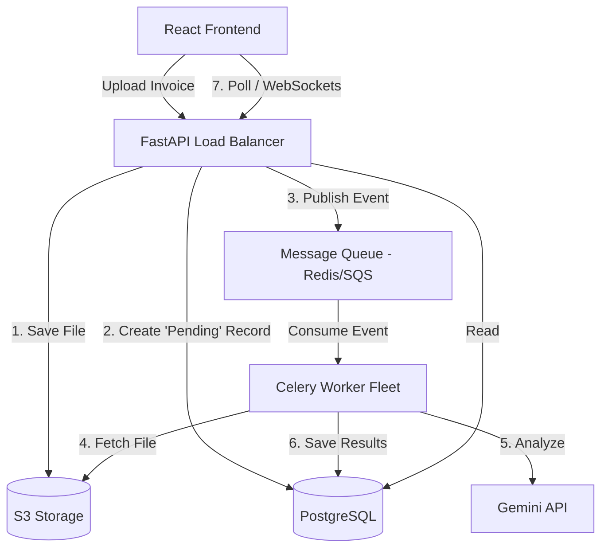

# Finance Operations Copilot: Enterprise Architecture Plan

This document outlines the architectural changes required to scale the Finance Operations Copilot from a local, single-node prototype to an enterprise-grade application capable of processing hundreds of thousands of invoices.

## Current Limitations & Bottlenecks

### 1. Synchronous Processing
**Limitation:** The `/invoice/analyze` endpoint makes a synchronous API call to Gemini. If the image is large or the API is slow, the HTTP request blocks, causing timeouts and tying up server resources.
**Bottleneck:** Web server thread exhaustion during high load or bulk invoice uploads.

### 2. Local File Storage
**Limitation:** Uploaded invoices are stored in the local `uploads/` directory.
**Bottleneck:** This makes the backend stateful. We cannot horizontally scale the FastAPI service (e.g., behind a load balancer) because uploaded files wouldn't be shared across instances.

### 3. SQLite Database
**Limitation:** The current `finance.db` is a local SQLite file.
**Bottleneck:** SQLite suffers from write locks during concurrent access and cannot be distributed across multiple containers or servers.

### 4. API Rate Limits
**Limitation:** We call Gemini Vision directly for every invoice.
**Bottleneck:** Enterprise volume will quickly hit Google's API rate limits if we do not queue, throttle, and backoff properly.

---

## Scalability Plan

### Step 1: Database Migration to PostgreSQL
**Action:** Replace SQLite with Amazon RDS PostgreSQL (or Cloud SQL).
**Benefit:** 
- Enables concurrent read/write operations without locking.
- Allows multiple FastAPI worker nodes to connect to a single source of truth.
- Provides better data indexing for Dashboard aggregations on large datasets.

### Step 2: Transition to S3 Object Storage
**Action:** Replace local file system operations with Amazon S3 (or Google Cloud Storage).
**Flow:**
1. Frontend uploads invoice directly to S3 via a pre-signed URL (or through the backend which immediately streams it to S3).
2. The database stores the `s3://` URI instead of a local file path.
**Benefit:** Infinite storage scaling and true statelessness for the web API tier.

### Step 3: Event-Driven Background Processing
**Action:** Introduce a message queue (e.g., RabbitMQ, AWS SQS, or Redis + Celery).
**New Workflow:**
1. User uploads invoice.
2. Web server saves metadata to DB (Status: `PENDING`) and drops a message onto the `invoice-processing-queue`.
3. Web server returns `202 Accepted` immediately.
4. Background Worker (Celery) picks up the task, fetches the image from S3, and calls Gemini Vision API.
5. Worker handles retries/rate-limits using exponential backoff.
6. Worker updates the DB with extracted JSON (Status: `COMPLETED`).
7. Client UI polls or receives a WebSocket/SSE notification that the invoice is ready.

### Step 4: AI Resiliency & Fallbacks
**Action:** Implement a Circuit Breaker pattern.
- If `gemini-1.5-flash` experiences downtime or rate limits, the queue pauses and exponentially backs off.
- Secondary failovers can be implemented (e.g., routing OCR to Google Cloud Document AI if Gemini Vision is unavailable).

## Proposed Enterprise Architecture Diagram

## Conclusion
By moving state out of the web tier (S3 + Postgres) and decoupling the heavy AI workloads (Queues + Workers), the Finance Operations Copilot can seamlessly scale to handle enterprise-level document volumes while remaining highly responsive to end-users.
