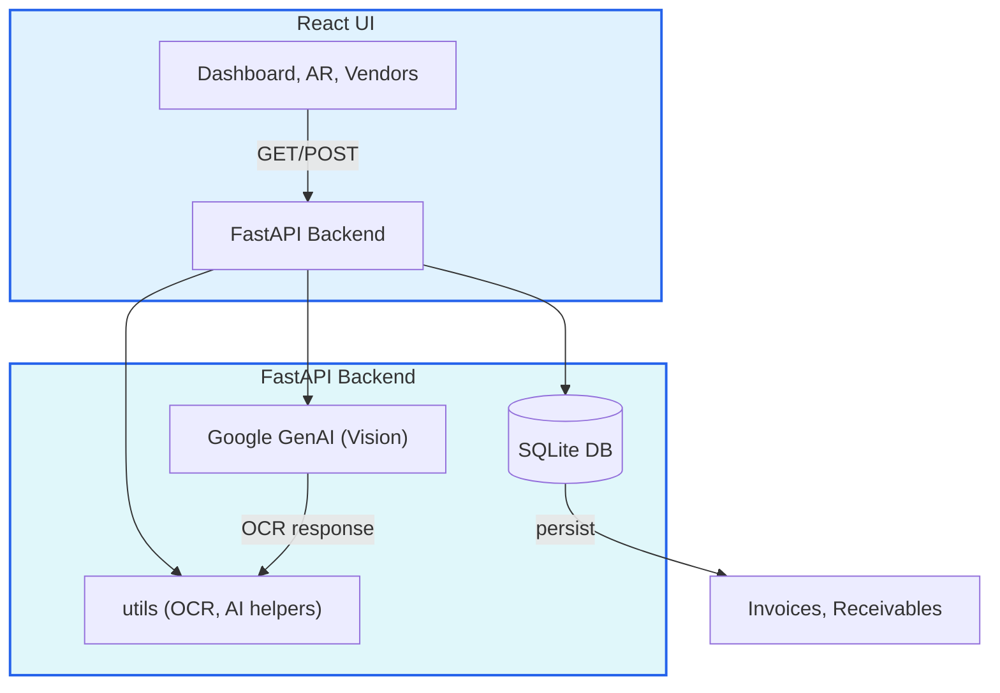

# Finance Operations Copilot

**A premium AI‑powered assistant for finance teams** that automates invoice extraction, vendor classification, priority scoring, receivable management, and AI‑generated email reminders.

---

## Project Overview

The application provides a comprehensive end-to-end finance operations workflow:
1. **Dashboard & Cash Flow:** Track total payables, cash flow impact, and overdue liabilities.
2. **Invoice Intelligence:** Upload an invoice image. Extract key fields and classify vendors using Google Gemini Vision.
3. **Priority & Duplicates:** Compute an AI-first priority score and flag potential duplicate invoices.
4. **Vendor Analytics:** Analyze vendor spend, categories, and risks across your supply chain.
5. **Accounts Receivable:** Track AR aging, assign risk levels, and automatically draft contextual follow-up emails via Gemini AI.

All components are **container‑ready**, written in modern FastAPI and React with a polished UI, and charted using Recharts.

---

## Architecture (Local Prototype)



*Note: For enterprise scale capabilities, please see [Architecture.md](./Architecture.md).*

---

## Features

- **Finance Dashboard:** Key metrics, 30-day cash flow Recharts graph, and due-date tracking.
- **Invoice OCR & Unified Analysis:** One-shot Gemini Vision API call for extraction, classification, duplicate checking, and prioritization.
- **Vendor Analytics:** Aggregate total spend and risk profiles.
- **Accounts Receivable Workflow:** Overdue tracking and customer risk assessments.
- **AI Email Generation:** Dynamic prompt tuning for Friendly, Second, and Final notices.
- **Full API:** Documented REST endpoints with graceful error handling.

---

## Tech Stack

| Layer | Tech |
|-------|------|
| Frontend | React + Vite, TailwindCSS, Recharts |
| Backend | FastAPI, SQLite, Pydantic, Uvicorn |
| AI | Google GenAI SDK (`google.genai`), Gemini 1.5 Flash / 2.5 Flash |
| Infrastructure | Standalone local dev, easily containerizable |

---

## Setup Instructions

1. **Clone the repository** (already published).
2. **Backend**:
   ```bash
   cd backend
   python3 -m venv venv
   source venv/bin/activate
   pip install -r requirements.txt
   # .env should contain GEMINI_API_KEY
   uvicorn app.main:app --reload
   ```
3. **Seed Database (Optional but recommended)**:
   ```bash
   # From project root
   backend/venv/bin/python scripts/seed_data.py
   ```
4. **Frontend**:
   ```bash
   # In a new terminal
   npm install
   npm run dev   # Vite dev server on http://localhost:5173
   ```
5. Open the UI, click "Sync ERP Data" on the Receivables page, and view the populated Dashboard.

---

## Sample Data Assets

- `scripts/seed_data.py` - Clears and populates `finance.db` with realistic historical and future data.
- `sample_invoices.json` - Static sample dataset.
- `sample_receivables.json` - Static sample dataset.

---

## API Endpoints

### Dashboard
| Method | Path | Description |
|--------|------|-------------|
| `GET` | `/dashboard/metrics` | Summary metrics for invoices |
| `GET` | `/dashboard/cashflow` | 30-day cashflow grouping |
| `GET` | `/dashboard/vendors` | Aggregate vendor analytics |

### Invoice
| Method | Path | Description |
|--------|------|-------------|
| `GET` | `/invoice` | List all invoices |
| `POST` | `/invoice/analyze` | Unified AI processing |

### Receivable
| Method | Path | Description |
|--------|------|-------------|
| `GET` | `/receivable` | List all receivables |
| `POST` | `/receivable/mock_sync` | Sync 10 mock records |
| `GET` | `/receivable/{id}/email` | Generate reminder email (params: `reminder_type`) |

---

*Generated with Antigravity AI assistant.*
