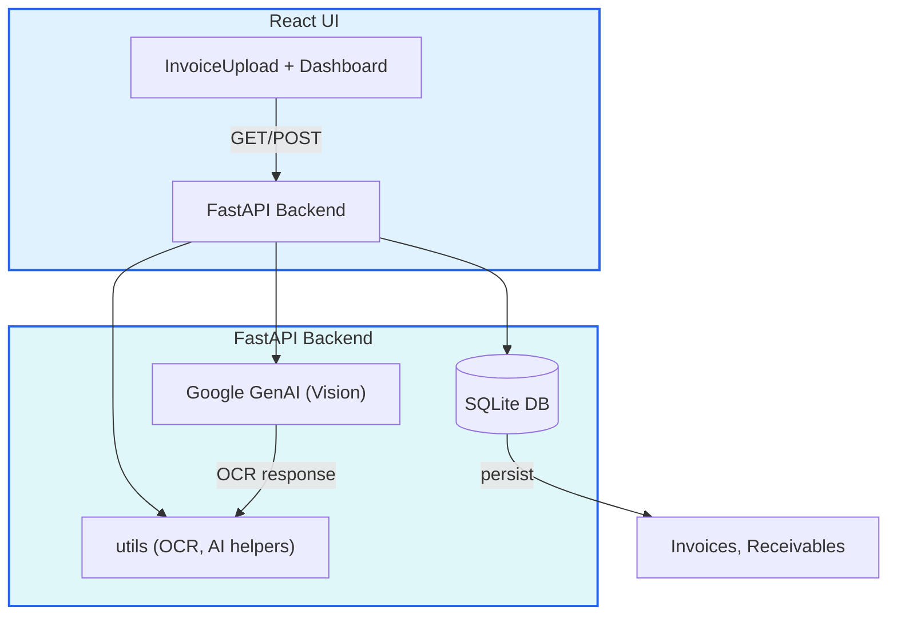

# README.md

## Finance Operations Copilot

**A premium AI‑powered assistant for finance teams** that automates invoice extraction, vendor classification, priority scoring, receivable management, and AI‑generated email reminders.

---

### Project Overview

The application provides a **single‑screen workflow**:
1. Upload an invoice image or PDF.
2. Extract key fields using Google Gemini Vision (or a deterministic fallback).
3. Classify the vendor and obtain reasoning.
4. Compute a priority score and recommendation.
5. Store receivables, generate email drafts, and expose a clean REST API.

All components are **container‑ready**, written in modern FastAPI and React with a polished UI.

---

### Architecture



---

### Features

- **Invoice OCR** (Google Gemini Vision) with deterministic mock fallback.
- **Vendor classification** using Gemini AI.
- **Priority scoring** and actionable recommendation.
- **Receivable workflow** – upload CSV, query priority, generate reminder emails.
- **AI email generation** (Gemini) for payment reminders.
- **Full API** – health, invoice, receivable, email endpoints.
- **Responsive UI** – glass‑morphism cards, status badges, loading states, empty states.

---

### Tech Stack

| Layer | Tech |
|-------|------|
| Frontend | React + Vite, vanilla CSS (custom design tokens), Material Icons SVG |
| Backend | FastAPI, SQLite, Pydantic, Uvicorn |
| AI | Google GenAI SDK (`google.genai`), Gemini multimodal models |
| DevOps | npm scripts, `npm run dev`, `uvicorn backend/app/main:app --reload` |

---

### Setup Instructions

1. **Clone the repository** (already published).
2. **Backend**:
   ```bash
   cd backend
   python3 -m venv venv
   source venv/bin/activate
   pip install -r requirements.txt
   # .env should contain GEMINI_API_KEY (already configured)
   uvicorn app.main:app --reload
   ```
3. **Frontend**:
   ```bash
   cd ../frontend
   npm install
   npm run dev   # Vite dev server on http://localhost:5173
   ```
4. Open the UI, upload an invoice, and watch the dashboard update.

---

### API Endpoints

| Method | Path | Description |
|--------|------|-------------|
| `GET` | `/health` | Health check |
| `POST` | `/invoice/upload` | Upload invoice file (multipart) |
| `GET` | `/invoice/{id}/extract` | Return extracted data |
| `GET` | `/invoice/{id}/classify` | Vendor classification |
| `GET` | `/invoice/{id}/priority` | Priority score & recommendation |
| `POST` | `/receivable/upload` | Bulk upload receivables CSV |
| `GET` | `/receivable/{id}/priority` | Receivable priority |
| `GET` | `/receivable/{id}/email` | Generate reminder email |
| `POST` | `/email/generate` | Custom email generation |

---

### Screenshots

*(Placeholders – replace with actual screenshots after running the demo)*


---

### Future Improvements

- Add **authentication/role‑based access**.
- Integrate with **ERP systems** (SAP, NetSuite).
- Expand to **cash‑flow forecasting**.
- Implement **AI‑driven payment scheduling**.
- Deploy to **cloud** with CI/CD pipelines.

---

### OCR Notes

- The code attempts to use the **first multimodal model** from the GenAI SDK (`google.genai`).
- If no API key is present or no suitable model is found, a **deterministic mock** based on file‑path hash is returned (ensuring different invoices produce different data).
- Logs clearly indicate whether real OCR was used or the fallback.

---

*Generated with Antigravity AI assistant.*
